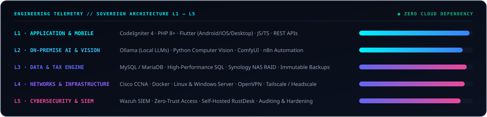

<!-- CINEMATIC ANIMATED HERO -->

 

<!-- LIVE TERMINAL TYPING -->

 

<!-- QUICK NAVIGATION & DIRECT CONTACT -->

[-3B82F6?style=for-the-badge&logo=readthedocs&logoColor=white&labelColor=0A0F1A)](https://pcruz.spire.pt/assets/pdf/CV_Pedro_Cruz_english.pdf)
[-6366F1?style=for-the-badge&logo=readthedocs&logoColor=white&labelColor=0A0F1A)](https://pcruz.spire.pt/assets/pdf/CV_Pedro_Cruz.pdf)

## `01 // ENGINEERING PHILOSOPHY`

> **"I build everything underneath it."**  
> I'm **Pedro Cruz**, a software and systems architect. I design the architecture, write the code, train the artificial intelligence layer, build the network and define the security — and then I answer for all of it in production.

I do not ship isolated prototypes or fragile wrappers. I engineer complete, sovereign ecosystems independent of unnecessary cloud subscriptions—where application software, on-premise AI models, relational databases, network routing (**CCNA**), and active security monitoring (**SIEM**) operate as a single, finely tuned machine.

## `02 // PRODUCTION ECOSYSTEMS (HIGHLIGHTS FROM 17+ PRODUCTS)`

Each platform was born out of a real operational problem in a real business and runs actively in production.

<table>
  <tr>
    <td width="50%" valign="top">
      <h3><code>01 · ERP PLATFORM</code> — <b>ACCGES</b></h3>
      
      
<b>The intelligent business management platform — fifteen modules, a single source of truth for the whole practice.</b>

      <ul>
        <li><b>Multi-company</b> architecture with fine-grained, per-role access permissions.</li>
        <li>Tax compliance, HR & payroll, document processing, expenses, construction, manufacturing, and POS.</li>
        <li>Integrated <b>AI Assistant</b> that queries live production data while strictly honoring user access rights.</li>
      </ul>
      

        
        
        
        
        
      

    </td>
    <td width="50%" valign="top">
      <h3><code>02 · HEALTHCARE & SURGERY</code> — <b>AnagenSys</b></h3>
      
      
<b>The complete system for hair transplant clinics: from the patient's first message to the operating theatre, on the web and in a native app.</b>

      <ul>
        <li>Surgical planning with an interactive <b>3D head model</b>, recipient zones, densities, and transparent clinical formulas.</li>
        <li>Live <b>Operating Theatre</b> view with surgical phases, precision timers, and real-time follicle count.</li>
        <li>Web and native <b>Flutter</b> app in strict parity across Android, iPhone, macOS, and Windows.</li>
      </ul>
      

        
        
        
        
      

    </td>
  </tr>
  <tr>
    <td width="50%" valign="top">
      <h3><code>03 · EDUCATION & LOCAL AI</code> — <b>Aularius</b></h3>
      
      
<b>Teaching software that takes work off the teacher: lesson summaries, worksheets, minutes, attendance, and assessment across every school.</b>

      <ul>
        <li>From pre-school to university: vocabulary, grading rules, and tools dynamically adapt to each academic level.</li>
        <li><b>On-premise AI assistant</b> that drafts lesson summaries, three-level worksheets, and meeting minutes — always awaiting confirmation.</li>
        <li>One teacher, several schools: unified timetable, classes, and attendance in a single workspace.</li>
      </ul>
      

        
        
        
        
      

    </td>
    <td width="50%" valign="top">
      <h3><code>04 · COMPUTER VISION</code> — <b>PHOTECH</b></h3>
      
      
<b>Event photography with biometric face search: one photo of yourself finds, in seconds, every image you appear in.</b>

      <ul>
        <li>High-precision <b>facial recognition</b> powered by a dedicated Python service, ranked by biometric similarity.</li>
        <li>Dedicated event portals with automated cart and instant checkout per individual photo or full folder.</li>
        <li>High-speed bulk upload pipeline with automated thumbnail generation and duplicate detection.</li>
      </ul>
      

        
        
        
        
      

    </td>
  </tr>
</table>

> 🔗 **[Explore all 17+ production systems and technical case studies at `pcruz.spire.pt` →](https://pcruz.spire.pt/?lang=en#trabalho)**

## `03 // SYSTEM STACK & ARCHITECTURE (L1 → L5)`

  

## `04 // ENGINEERING DOMAINS & SERVICES`

| Domain | Production Deliverables |
| :--- | :--- |
| **01 · Custom Architecture & Software** | End-to-end engineering of multi-tenant ERP/BMS platforms, industrial management systems, client portals, and native **Flutter** apps (Android, iOS, Windows, macOS) paired with **CodeIgniter 4 / PHP** backends. |
| **02 · On-Premise AI & Computer Vision** | Deployment of sovereign local LLMs (**Ollama**), permission-aware enterprise data agents, biometric facial recognition services in **Python**, and automated pipelines with **n8n**. |
| **03 · Networks, Bare-Metal & Security** | Certified network architecture (**Cisco CCNA**), self-hosted servers & NAS clusters, encrypted mesh VPNs (**Tailscale / Headscale / OpenVPN**), and active threat monitoring with **Wazuh SIEM**. |

## `05 // GITHUB TELEMETRY & ACTIVITY`

 

### `06 // GET IN TOUCH`

Available for new custom software architecture, private AI integration, and critical infrastructure projects.

[**🌐 pcruz.spire.pt**](https://pcruz.spire.pt/?lang=en) · [**✉️ pcruz@spire.pt**](mailto:pcruz@spire.pt) · [**📞 +351 963 503 544**](https://pcruz.spire.pt/?lang=en#contacto)

⚡ Engineered from the ground up by <b>Pedro Cruz (LN-Dark)</b> · Spire & AccounTech

