<div align="center">

<!-- HERO CINEMATOGRÁFICO ANIMADO -->
<a href="https://pcruz.spire.pt/?lang=pt">
  
</a>

<br/>

<!-- EFEITO DE TYPING EM TEMPO REAL -->
<a href="https://pcruz.spire.pt/?lang=pt">
  
</a>

<br/>

<!-- NAVEGAÇÃO RÁPIDA & CONTACTO DIRETO -->
[](https://pcruz.spire.pt/?lang=pt)
[-3B82F6?style=for-the-badge&logo=readthedocs&logoColor=white&labelColor=0A0F1A)](https://pcruz.spire.pt/assets/pdf/CV_Pedro_Cruz.pdf)
[-6366F1?style=for-the-badge&logo=readthedocs&logoColor=white&labelColor=0A0F1A)](https://pcruz.spire.pt/assets/pdf/CV_Pedro_Cruz_english.pdf)
[](mailto:pcruz@spire.pt)

</div>


## `01 // A FILOSOFIA DE ENGENHARIA`

> **"Construo tudo o que está por baixo."**  
> Desenho a arquitetura, escrevo o código, treino a camada de inteligência artificial, monto a rede e defino a segurança — e depois respondo por tudo em produção.

Não entrego apenas interfaces ou protótipos isolados. Construo ecossistemas completos, soberanos e independentes de subscrições *cloud* desnecessárias, onde o software aplicacional, os modelos de IA locais (*on-premise*), as bases de dados, o encaminhamento de rede e a monitorização de segurança (**SIEM**) operam como uma única máquina afinada.


## `02 // ECOSSISTEMAS EM PRODUÇÃO (DESTAQUES DE 17+ PRODUTOS)`

Cada plataforma nasceu de um problema real de operação, engenharia ou indústria e encontra-se em produção ativa.

<table>
  <tr>
    <td width="50%" valign="top">
      <h3><code>01 · PLATAFORMA ERP</code> — <b>ACCGES</b></h3>
      <a href="https://pcruz.spire.pt/?lang=pt#trabalho">
        
      </a>
      <p><b>A plataforma de gestão empresarial inteligente — 15 módulos, uma única fonte de verdade para todo o gabinete.</b></p>
      <ul>
        <li>Arquitetura <b>multi-empresa</b> com controlo de permissões granular ao detalhe por perfil.</li>
        <li>Módulos integrados de Fiscalidade, RH e Salários, Documentos, Despesas, Obras, Produção e POS.</li>
        <li>Assistente de <b>IA integrado</b> que consulta dados reais em tempo real respeitando os níveis de acesso.</li>
      </ul>
      <p>
        
        
        
        
        
      </p>
    </td>
    <td width="50%" valign="top">
      <h3><code>02 · SAÚDE & BLOCO CIRÚRGICO</code> — <b>AnagenSys</b></h3>
      <a href="https://pcruz.spire.pt/?lang=pt#trabalho">
        
      </a>
      <p><b>Sistema clínico completo para transplante capilar: da triagem ao bloco operatório, na web e em app nativa.</b></p>
      <ul>
        <li>Planeamento cirúrgico interativo com <b>modelo 3D</b>, mapeamento de zonas recetoras e cálculo densitométrico.</li>
        <li>Modo de <b>Bloco Operatório</b> com fases cirúrgicas, cronómetros e contagem de folículos em tempo real.</li>
        <li>Paridade estrita entre plataforma Web e aplicação nativa <b>Flutter</b> (Android, iOS, macOS e Windows).</li>
      </ul>
      <p>
        
        
        
        
      </p>
    </td>
  </tr>
  <tr>
    <td width="50%" valign="top">
      <h3><code>03 · EDUCAÇÃO & IA LOCAL</code> — <b>Aularius</b></h3>
      <a href="https://pcruz.spire.pt/?lang=pt#trabalho">
        
      </a>
      <p><b>Software docente autónomo: sumários, fichas, atas, faltas e avaliação multi-escola preparados automaticamente.</b></p>
      <ul>
        <li>Adaptação dinâmica de vocabulário, grelhas e regras desde o ensino pré-escolar até ao universitário.</li>
        <li>Motor de <b>IA local (On-Premise)</b> que redige sumários, fichas diferenciadas em 3 níveis e atas para validação.</li>
        <li>Gestão centralizada multi-instituição: horários, turmas e presenças num painel único.</li>
      </ul>
      <p>
        
        
        
        
      </p>
    </td>
    <td width="50%" valign="top">
      <h3><code>04 · VISÃO COMPUTACIONAL</code> — <b>PHOTECH</b></h3>
      <a href="https://pcruz.spire.pt/?lang=pt#trabalho">
        
      </a>
      <p><b>Plataforma de fotografia de eventos com pesquisa biométrica: uma selfie encontra todas as fotos em segundos.</b></p>
      <ul>
        <li>Microserviço dedicado em <b>Python</b> para extração de *embeddings* faciais e ordenação por semelhança.</li>
        <li>Processamento em lote de alta velocidade com geração automática de miniaturas, marcas de água e deteção de duplicados.</li>
        <li>Galerias privadas por evento com carrinho e compra direta por fotografia ou álbum completo.</li>
      </ul>
      <p>
        
        
        
        
      </p>
    </td>
  </tr>
</table>

> 🔗 **[Explorar os 17+ projetos em produção e detalhes de arquitetura em `pcruz.spire.pt` →](https://pcruz.spire.pt/?lang=pt#trabalho)**


## `03 // PILHA DO SISTEMA (L1 → L5 ARCHITECTURE)`

A minha intervenção cobre todas as camadas do ciclo de vida tecnológico, sem caixas negras:

```text
┌──────────────────────────────────────────────────────────────────────────────────────────┐
│  L1 · CAMADA APLICACIONAL & UX      CodeIgniter 4 · PHP 8+ · Flutter · JS/TS · HTML5/CSS │
├──────────────────────────────────────────────────────────────────────────────────────────┤
│  L2 · INTELIGÊNCIA & AUTOMAÇÃO      Ollama (LLMs Locais) · Python Vision · ComfyUI · n8n │
├──────────────────────────────────────────────────────────────────────────────────────────┤
│  L3 · DADOS & ARMAZENAMENTO         MySQL / MariaDB · SQL Tuning · Synology NAS · RAID   │
├──────────────────────────────────────────────────────────────────────────────────────────┤
│  L4 · REDES & INFRAESTRUTURA        Cisco CCNA · Docker · Linux/Windows Server · VPNs    │
├──────────────────────────────────────────────────────────────────────────────────────────┤
│  L5 · CIBERSEGURANÇA & CONTROLO     Wazuh SIEM · Tailscale/Headscale · Hardening · Audit │
└──────────────────────────────────────────────────────────────────────────────────────────┘
